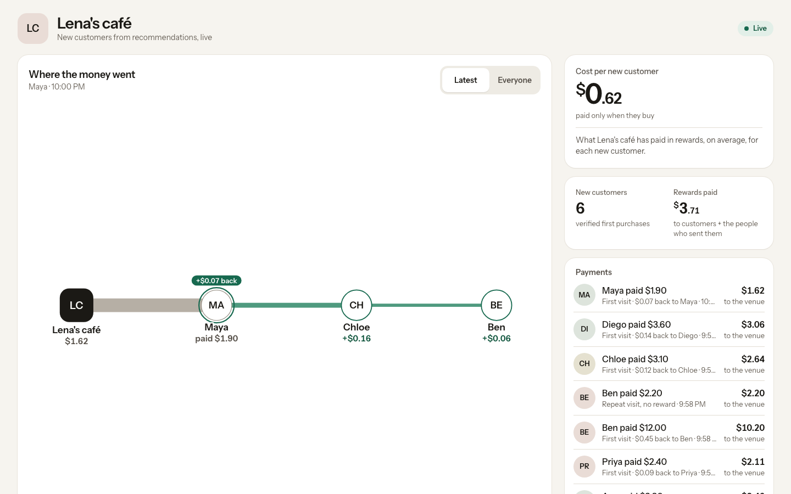
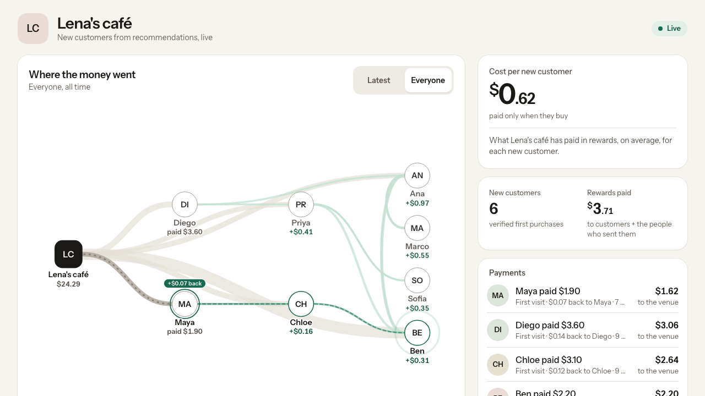
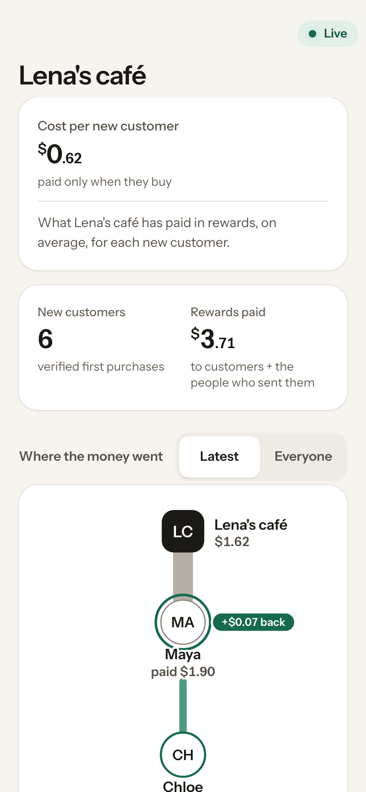
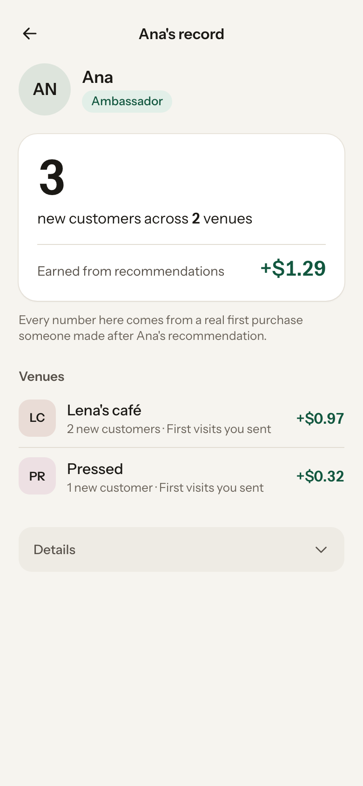
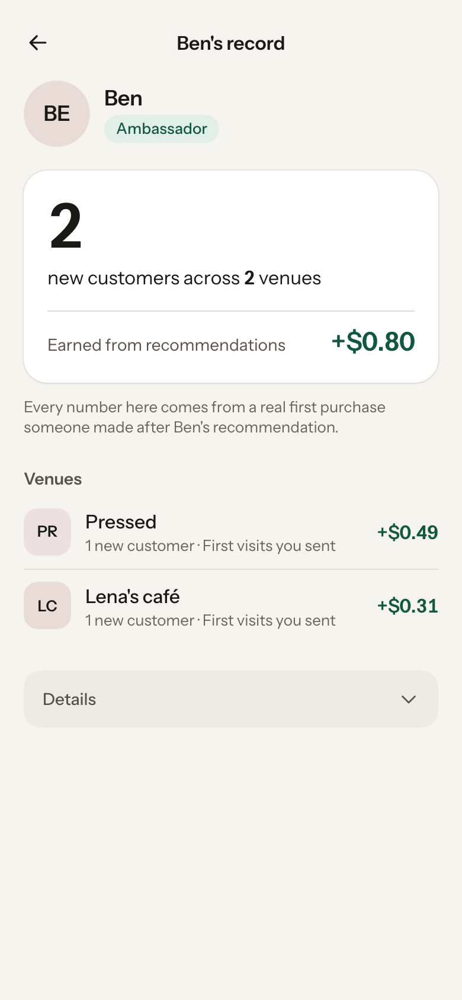
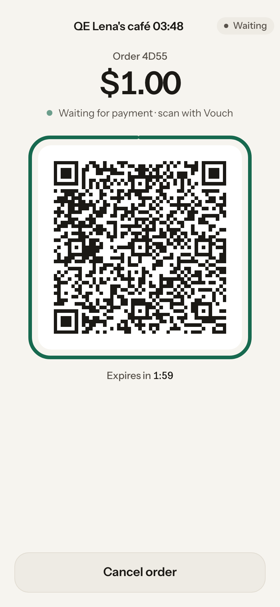
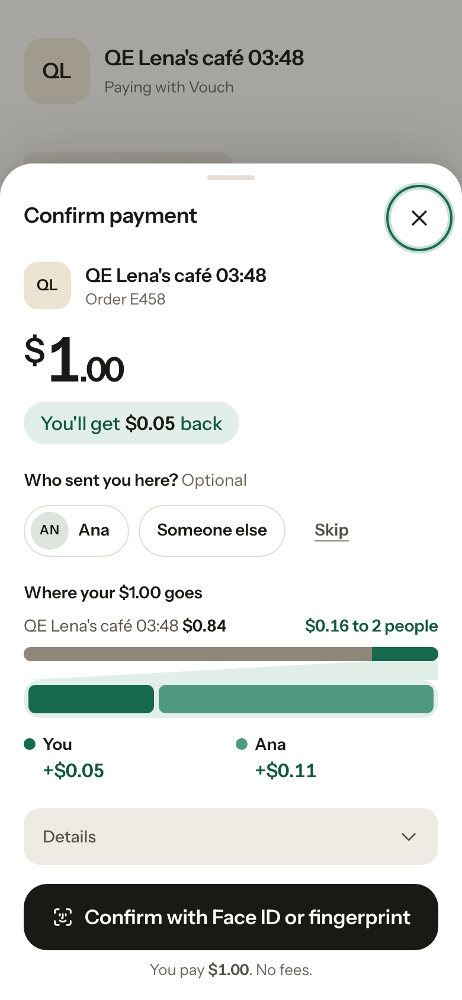
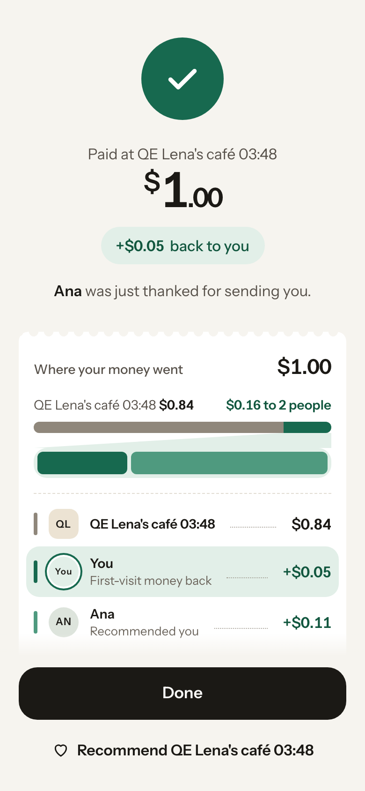
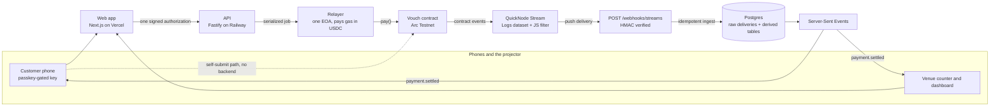

# Vouch

**Vouch is a pay-per-verified-customer marketing network for local businesses. Customers pay in USDC on Arc, and the sale itself instantly pays the people whose recommendations brought them in.**

**Christian Dizon, Rutgers University, built solo.**

Built for the UBC 2026 Hackathon. Tracks: **Consumer Applications** · **Best use of Arc** · **QuickNode Streams bounty**.

| | |
|---|---|
| **Live app** | https://vouch-ubc.vercel.app (open it on a phone; the venue dashboard also works on a laptop or projector) |
| **API** | https://api-production-902bc54c.up.railway.app/health |
| **Contract** | Vouch v3 [`0xF4B641dc628de05336aa983B07D5d181254ff08e`](https://explorer.testnet.arc.io/address/0xF4B641dc628de05336aa983B07D5d181254ff08e) on Arc Testnet (chain 5042002), Blockscout-verified |
| **Stream** | QuickNode Stream `vouch-v3-production` (ID `6b792277-2c66-4c0c-a141-4d452cddfdf8`) |
| **Demo video** | `<VIDEO_URL>` |
| **How payments split** | https://vouch-ubc.vercel.app/transparency |
| **Demo venue** | Lena's café dashboard: https://vouch-ubc.vercel.app/venue/0x9a40C2b1Da073Fea51A63B92f868A78969c56289 (sign in first; any new account works) |
| **Repository** | https://github.com/christiandiz0n/vouch |

> This is a prototype on a testnet. No real money moves, nothing here is audited, and it is not legal, tax or financial advice.

---

## The problem

Small businesses like cafés, barbers and salons spend money on ads they can't attribute. Most of their real growth comes from word of mouth, and the people doing the recommending earn nothing for it. Referral programs exist, but a small business can't build one: it needs software, fraud control and payouts. The platforms that run these programs take a cut and can change the terms whenever they like.

Vouch makes a recommendation pay at the moment it works. The venue sets a reward rate for a customer's first purchase. When a referred customer pays, one transaction splits that payment between the venue, the new customer (as money back) and the people who sent them. The venue pays only for verified customers who actually bought something.

## Screenshots

All taken on production (https://vouch-ubc.vercel.app) against the seeded demo data: three venues (Lena's café at 15%, Kiln Bakery, Pressed) and about a dozen people, all with real payments on Arc Testnet. <!-- evidence: docs/qa/phase-5-prod-regression.md §2 (numbers cross-checked against the hosted /stats, /payments, /ambassadors); P5-01 shots: docs/evidence/phase-5/prod/p5-01/ -->

**Venue dashboard on a projector (1440×900):** cost per new customer, new customers, rewards paid, the money graph for the latest payment, and the payments feed. Ben's $12.00 first visit (the canonical split below) is in the feed.



**"Everyone" view:** every recommendation that brought a paying customer to Lena's café, and what each person earned.



| Venue dashboard on a phone | Ana's public record | Ben's public record |
|---|---|---|
|  |  |  |

**The payment flow** (from the independent Phase 3 QE run on the deployed stack: two fresh accounts, a $1.00 order at a 20% reward rate, live Stream): <!-- evidence: docs/qa/phase-3-qe-gate.md §3, docs/evidence/phase-3/qe/screens/ -->

| Counter QR | Pay sheet | Paid, with split receipt |
|---|---|---|
|  |  |  |

---

## How it works (the canonical $12.00 story)

1. **Lena's café** registers as a venue and sets a reward of **15%** on a customer's first purchase. The terms are stored on-chain and versioned.
2. **Ana**, already a verified customer, taps **Recommend** and sends **Ben** a personal link. The link carries a signed intro naming the referrer, the venue, the terms version, a timestamp and a nonce. Ben opens it while signed in and countersigns it. His coworker **Priya** also sent him a group-chat link.
3. At the counter, Lena keys in **$12.00**. The screen shows a QR code with a venue-signed order.
4. Ben scans the code and sees *"You'll get $0.45 back"* plus an optional *"Who sent you here?"*. He confirms with **Face ID or fingerprint**.
5. **One transaction on Arc** splits the $12.00. Attribution gives Ana 70% and Priya 30%.

| Recipient | Rule | Amount |
|---|---|---|
| Reward pool | 15% × $12.00 | $1.80 |
| Ben (welcome money back) | 25% of the pool | **$0.45** |
| Ana (recommended him, 70%) | 55% of the pool × 70% | **$0.693** |
| Priya (recommended him, 30%) | 55% of the pool × 30% | **$0.297** |
| Whoever introduced Ana | 20% of the pool × 70% | **$0.252** |
| Whoever introduced Priya | 20% of the pool × 30% | **$0.108** |
| Lena's café | the remainder | **$10.20** |
| **Total** | | **$12.00 exactly** |

6. Every screen updates within about two seconds (measured tap → settled: 1.35–1.45 s). Lena's dashboard animates the money graph through the referral chain.
7. Ben is now a verified customer and can recommend the café himself. Ana's ambassador record grows. Ben's later purchases are plain payments with no reward.

**This exact split has run on chain twice through the hosted stack:**

| Run | Transaction | Payees |
|---|---|---|
| Seeded demo data, Lena's café (Ben, Ana, Priya, and their introducers Marco and Sofia) | [`0x83214e73…71f980`](https://explorer.testnet.arc.io/tx/0x83214e735269dc32850d18381fb229e8406fdbd5ea0ee4b9f85c1a73f071f980), block 72,958,157 | **6 distinct addresses**: the café's payout address, Ben, Ana, Priya, Marco, Sofia <!-- evidence: cast receipt 0x83214e73… re-read 2026-11-20 by DOCS_SUBMISSION: USDC Transfer logs 67 (12.00 in), 69/71/73/75/77/79 out; payees 0x5d71…d794 Ben, 0x995b…d26f Ana, 0xf066…0434 Priya, 0x09b9…ce82 Marco, 0x9d6b…7e7a Sofia, 0x7e86…c4a7 venue payout; names from the hosted /venues/0x9a40…/payments --> |
| Phase 2 live check (QE Part B) | [`0x40147554…ddfcb`](https://explorer.testnet.arc.io/tx/0x40147554390c5de5d702a0086a1b144730abca46ff39d2ab642945a7791ddfcb), block 72,890,535 | 5 distinct addresses: in that test the same wallet was Ana and Priya's introducer, so it received both 0.693 and 0.108 <!-- evidence: cast receipt 0x40147554… (USDC Transfer logs 23,25,27,29,31,33,35) re-read 2026-11-20; docs/evidence/phase-2/qe/part-b-latency-summary.txt; docs/qa/phase-2-qe-e2e.md Part B --> |

Both moved 12,000,000 base units in and paid out 10,200,000 / 450,000 / 693,000 / 297,000 / 252,000 / 108,000.

**Rounding rule** (D-503/D-504): all math uses integer USDC base units (6 decimals). Each referrer gets a slice, `floor(amount × weight × frozenRate / 10,000²)`. Each slice is split 25/55/20, and every share is **floored**. The venue gets `amount − Σ(shares actually transferred)`, so rounding dust and any undistributable share (for example a referrer with no introducer) go back to the venue. **The payouts always sum exactly to the sale.** Indexers check `PaymentSettled.venueAmount + Σ RewardPaid.amount == amount`.

---

## Architecture

<!-- TODO(orchestrator): the repo is public; after pushing, open this README on github.com in a private window and check that this Mermaid diagram renders (it was reviewed by hand, never machine-rendered). If it shows as a code block or an error, simplify the labels. -->



- **The web app** (`apps/web`, Next.js 16, React 19, Tailwind 4) is mobile-first. Each browser holds its own key, and the key never leaves the device.
- **The API** (`apps/api`, Fastify 5, Drizzle, Postgres on Railway, PGlite locally) handles sign-in, venues, signed orders, intros, payment quotes, the relayer, the Streams webhook and SSE.
- **The contract** (`contracts/`, Solidity 0.8.30, Foundry) holds every rule about money.
- **Shared types** (`packages/shared`) hold the ABI, the EIP-712 types, the deployments and the constants. Contract, API and web all use the same source.
- **"Settled" only ever comes from Streams.** The relayer's answer is shown as *pending*. A payment turns green only after the Stream delivers its `PaymentSettled` event (D-803, D-904).

---

## How we use Arc

**USDC is the gas token, so a full two-level split costs about a cent or less, and the cost is a dollar amount you can predict.** We read these receipts from `https://rpc.testnet.arc.io` with `cast receipt`. The fee is `gasUsed × effectiveGasPrice`, in 18-decimal native USDC.

| Payment | Recipients | Gas used | Effective gas price | Fee (USDC) |
|---|---|---|---|---|
| Canonical $12.00, two levels: [`0x40147554…ddfcb`](https://explorer.testnet.arc.io/tx/0x40147554390c5de5d702a0086a1b144730abca46ff39d2ab642945a7791ddfcb) | 6 payouts (venue, cashback, 2 direct, 2 second-level) | 375,553 <!-- evidence: cast receipt, gasUsed 0x5bb01 --> | 22.8 gwei | **0.0085626** (≈ $0.0086, or 0.07% of the sale) <!-- evidence: 375553 × 22.8e9 wei = 8.5626084e15 wei / 1e18 --> |
| Seeded canonical $12.00, two levels, 6 distinct payees: [`0x83214e73…71f980`](https://explorer.testnet.arc.io/tx/0x83214e735269dc32850d18381fb229e8406fdbd5ea0ee4b9f85c1a73f071f980) | 6 payouts | 494,313 <!-- evidence: cast receipt 2026-11-20, gasUsed 494313 --> | 25.0 gwei | **0.0123578** (≈ $0.012, or 0.10% of the sale) <!-- evidence: 494313 × 25e9 / 1e18 = 0.012357825 --> |
| Live phone run, $1.00, one referrer, second-level share returned to the venue: [`0x67fd5b7a…edfd7`](https://explorer.testnet.arc.io/tx/0x67fd5b7a51b4d67ca7a82245817bc3d377242ddfd1ccc7a43ecbccce8ccedfd7) | 3 payouts + 1 returned share | 321,489 <!-- evidence: cast receipt --> | 25.0 gwei | **0.0080372** (≈ $0.0080) <!-- evidence: 321489 × 25e9 / 1e18; matches docs/qa/phase-3-qe-gate.md -->|
| Self-submit (customer sends `pay` and pays gas himself): [`0xfca0e1ae…8c7be`](https://explorer.testnet.arc.io/tx/0xfca0e1aeb40f9aa4e8564a60d0ac56817297956b2560d9db9bdc8823aa18c7be) | 6 payouts | 371,065 <!-- evidence: cast receipt; from 0xb333…2344 (the customer) --> | 25.0 gwei | **0.0092766** (≈ $0.0093) <!-- evidence: 371065 × 25e9 / 1e18 --> |

*These are testnet numbers. The same $12.00 split used 375,553 gas in one run and 494,313 in another, and the gas price was 22.8 vs 25 gwei, so the fee ranged from $0.0086 to $0.0124. Arc's base fee floor is 20 gwei (D-101). Mainnet fees may differ.*

**What Arc gives us, concretely:**
- **One balance, one unit.** The relayer pays gas in the same USDC the customer spends. There is no second token to buy, bridge or explain, and the cost of a payment is a dollar figure the business can budget. Native USDC (18 decimals) and the ERC-20 at `0x3600…0000` (6 decimals) are the same balance (D-102). The contract uses only the 6-decimal ERC-20 and is non-payable.
- **Gasless for the customer through EIP-3009.** The customer signs exactly one message, a USDC `ReceiveWithAuthorization` from themselves to the Vouch contract for the exact amount. Its `nonce` is the EIP-712 hash of our `PaymentAuth`, which covers the venue, order, amount, a commitment to the attribution weights, the deadline and the submitter. Vouch calls `USDC.receiveWithAuthorization`, which only the payee can call, so the authorization can't be front-run. The split then happens in the same transaction (D-103, D-509). The customer grants no allowance and needs no gas.
- **A relayer, but no trust in it for money.** One relayer key submits jobs strictly in order, with simulation before sending, fee caps, a spend budget and rate limits (D-801, D-808). The relayer can't change the amount, the recipients or the weights. The customer's authorization pins all of them, and a weights mismatch only falls back to the neutral on-chain rule. The web app also refuses to sign anything that doesn't match the scanned order (D-903).
- **Customer self-submit: no operator needed.** `PaymentAuth.submitter` is either the relayer or the customer, and the contract enforces `msg.sender == auth.submitter` (D-519). If our backend disappears, a customer can sign with `submitter = self` and call `pay` directly, paying the gas in USDC. The self-submit transaction above proves this path on chain. In this build it runs from the CLI (`pnpm --filter @vouch/scripts smoke:canonical -- --self-submit`), and there is no in-app button.
- **Fast blocks and deterministic finality** (about 0.7 s blocks, no reorgs, D-101). That is why the Stream runs with a latest-block delay of 0 and why we can call a payment settled after a single delivery.
- **Standard EVM tooling.** We used Foundry for building, fuzzing, invariant tests and fork tests against real Arc USDC, deployed with Blockscout verification, and used viem in TypeScript.

### Contract addresses (Arc Testnet, chain ID 5042002)

| Contract | Address | Notes |
|---|---|---|
| **Vouch v3 (live)** | [`0xF4B641dc628de05336aa983B07D5d181254ff08e`](https://explorer.testnet.arc.io/address/0xF4B641dc628de05336aa983B07D5d181254ff08e) | Deploy block 72,605,845, tx [`0x7a9bd4b1…8dc2709`](https://explorer.testnet.arc.io/tx/0x7a9bd4b1f61888606b91e2a58f6a61efa2761e810216b04730addfead8dc2709). Blockscout-verified (partial match, metadata hash off). Runtime 23,998 bytes. <!-- evidence: Blockscout API is_verified=true, is_partially_verified=true; cast codesize = 23998; packages/shared/src/deployments.ts --> |
| USDC (Arc system token) | [`0x3600000000000000000000000000000000000000`](https://explorer.testnet.arc.io/address/0x3600000000000000000000000000000000000000) | 6 decimals as an ERC-20 <!-- evidence: cast call decimals() = 6 --> |
| Relayer (EOA) | [`0x3eAFdcE9B632C036146960A03Db720dc84568daD`](https://explorer.testnet.arc.io/address/0x3eAFdcE9B632C036146960A03Db720dc84568daD) | Sender of the relayed payments above |
| Retired: Vouch v2 | `0x9C502fBF77BF31c6e88C92b55D1c67A21491b95f` | Replaced by v3 (submitter rule); never use |
| Retired: Vouch v1 | `0xfEe6CA5a9523715146374FEd857E63DE7DcCb2d3` | Replaced by v2 (QE fixes); never use |

---

## QuickNode Streams

**Streams is Vouch's source of truth for everything that has happened.** The app never takes the backend's word about money. When the relayer submits a payment, the screens show it as *pending*. It becomes *settled* only when the Stream delivers the contract's `PaymentSettled` event. Every number a user sees comes from Streams events: the split receipt, money back, the ambassador record, verified customers, live intros, venue terms and the venue's cost per new customer.

| Setting | Value |
|---|---|
| Stream | `vouch-v3-production`, ID `6b792277-2c66-4c0c-a141-4d452cddfdf8`, created in the QuickNode dashboard (the Streams REST API isn't available on trial plans, D-011) |
| Network | **Arc Testnet** (`arc-testnet`) |
| Dataset | **Logs** |
| Range | From block **72,605,845** (the Vouch v3 deploy block), running continuously. Latest-block delay 0, since Arc has no reorgs. |
| Filter | JavaScript `main(stream)`, [`docs/streams/filter-vouch.js`](docs/streams/filter-vouch.js) (shown below) |
| Destination | **Webhook** → `https://api-production-902bc54c.up.railway.app/webhooks/streams`, compression none |
| Security | QuickNode HMAC: `X-QN-Signature` = hex HMAC-SHA256(token, nonce + timestamp + body). The check is constant-time and fails closed (503 with no token, 401 for a bad or missing signature). Header checks and size caps run before anything is decoded (D-301, D-308). An unsigned POST to the live endpoint gets `401`. <!-- evidence: curl -X POST unsigned → 401, 2026-11-18 by DOCS_SUBMISSION --> |
| Config as data | [`infra/streams/stream-vouch-prod.json`](infra/streams/stream-vouch-prod.json), including the dashboard "Test filter" expectations |

### Filter logic

The filter keeps a log only if it was **emitted by the Vouch contract** and its **topic0 is one of our 10 events**. For a batch with no Vouch activity it returns `null`, so nothing is delivered. That drops USDC transfers and Arc's EIP-7708 system `Transfer` logs from `0xffff…fffe`. It walks the payload defensively, because QuickNode's documentation shows more than one nesting shape. Its output is a small envelope: `{v, streamId, network, dataset, batchStart, batchEnd, batchSource, events}`.

```js
const ADDRESSES = ["0xf4b641dc628de05336aa983b07d5d181254ff08e"];
const TOPICS = {
  "0xca816bf56b298971c59e72dcd003c06b351b66ffedb5ec84017d6195ec0152c8": "CustomerVerified",
  "0xe75b5b5d835a46c918feb6cac867d2b1c6ed4d45a112ebaf7067bb9c1fcf37fc": "IntroAccepted",
  "0x71760f14b6c295e573eb0712240020bcabda6d58907c0f3897ecf55f9ec193ea": "IntroDropped",
  "0x35f580066b94268579e33474e66ad0347864c26fe8683e577efb5072c80e7432": "PaymentSettled",
  "0xd28b9898dcd3318ef486fd51dbeba03ddb126bdb888b82d4ac7504213412b36a": "RewardPaid",
  "0x1cba477ed7240b8110e7fecc9c7f6fd041255365455d9c76f2b2febb4cfb7a15": "RewardReturned",
  "0x213904416ef720404e57b83f59ff9f8b5029132b1581c57443cf044b11a835b2": "SeedAmbassadorSet",
  "0x86d80d9334324698e8c0763e1f6a4179b0ae6af2e64a9724746ce284ec78bb8b": "TermsUpdated",
  "0xc518545d9074ed155beb97a3caed0bbecc0d2cdcdee6d6d2d16a079883ab2ee2": "VenueKeysUpdated",
  "0xf0f4291fd5fccc2af9a998b6cf8aba2121c99823a21bcfac7a4821537f004d77": "VenueRegistered"
};

function collectLogs(node, out, depth) {          // walk [block][receipt][log] or {logs:[…]} to depth 8
  if (depth > 8 || node === null || typeof node !== 'object') return;
  if (Array.isArray(node)) { for (let i = 0; i < node.length; i++) collectLogs(node[i], out, depth + 1); return; }
  if (Array.isArray(node.topics)) { out.push(node); return; }
  if (Array.isArray(node.logs)) collectLogs(node.logs, out, depth + 1);
}

function toNum(v) { return typeof v === 'number' ? v : (typeof v === 'string' && v.length > 0 ? (v.indexOf('0x') === 0 ? parseInt(v, 16) : Number(v)) : null); }

function main(stream) {
  const root = stream && stream.data !== undefined ? stream.data : stream;
  const meta = (stream && stream.metadata) || {};
  const logs = []; collectLogs(root, logs, 0);
  const events = [];
  for (const log of logs) {
    const address = typeof log.address === 'string' ? log.address.toLowerCase() : '';
    if (!ADDRESSES.includes(address)) continue;                        // only our contract
    const topic0 = typeof log.topics[0] === 'string' ? log.topics[0].toLowerCase() : '';
    if (!Object.prototype.hasOwnProperty.call(TOPICS, topic0)) continue; // only our 10 events
    events.push({ event: TOPICS[topic0], address, topics: log.topics, data: log.data,
                  blockNumber: toNum(log.blockNumber), blockHash: log.blockHash,
                  transactionHash: log.transactionHash, transactionIndex: toNum(log.transactionIndex),
                  logIndex: toNum(log.logIndex), removed: !!log.removed });
  }
  if (events.length === 0) return null;                               // nothing delivered
  return { v: 1, streamId: meta.stream_id, network: meta.network, dataset: meta.dataset,
           batchStart: toNum(meta.batch_start_range), batchEnd: toNum(meta.batch_end_range),
           batchSource: 'metadata', events };
}
```
*Condensed for reading. The exact file pasted into the dashboard is [`docs/streams/filter-vouch.js`](docs/streams/filter-vouch.js). It also carries `blockTimestamp`, converts hex numbers, and falls back to the min/max log block when metadata is absent.*

### What happens to a delivery

```
Arc block ─▶ QuickNode Stream (Logs + filter-vouch.js) ─▶ POST /webhooks/streams
  1. per-IP rate limit → secret configured? → X-QN-* headers present? → size caps → HMAC verify
  2. store the raw body in stream_deliveries (if that fails → 500, and QuickNode retries)
  3. decode with the shared Vouch ABI; INSERT … ON CONFLICT (txHash, logIndex) DO NOTHING
  4. apply the new events in (block, logIndex) order to the derived tables (venues, terms, intros,
     verified customers, payments, reward lines, venue stats, ambassador records), in one DB transaction
  5. publish on the in-process bus → Server-Sent Events to the venue and customer screens
```
- **Idempotent.** The key is `(transactionHash, logIndex)`, so QuickNode retries, overlapping batches and replays are no-ops.
- **Order-independent.** If an older event arrives late, the derived tables are rebuilt from the event log in chain order. The state is a pure function of *which* events exist (D-306).
- **Never loses a delivery.** The raw body is stored before we answer 200. If ingestion fails, the failure is recorded and retried from the stored row, and QuickNode is never forced into a retry loop (D-309).

### Why Streams, and not polling

1. **Push, with sub-second settlement.** Measured on the hosted stack, the Stream delivered the canonical payment's block **+0.147 s** after the relayer saw its receipt, and the `payment.settled` SSE event went out at **+0.144 s**. <!-- evidence: docs/evidence/phase-2/qe/part-b-latency-summary.txt (server and client clocks; SSE logged 3 ms before the delivery line) --> End to end on phones (Playwright, deployed web, live Stream), **tap → settled took 1.35 s and 1.45 s**, and the venue counter showed *Paid* after 1.79 s. <!-- evidence: docs/qa/phase-3-qe-gate.md §3 latency table -->
2. **Reproducible and auditable state.** Backfilling from the deploy block rebuilds exactly the same database (see below), so anyone can check our numbers against the chain.
3. **The filter runs at QuickNode.** We receive only our own events, not every block.
4. **One code path.** Live delivery, backfill and replay all go through the same filter file and the same ingest code.

### Proof: backfill, live, replay and rebuild agree

```bash
pnpm --silent --filter @vouch/scripts streams:verify
```
This builds the derived state in independent ways and compares a SHA-256 over every derived table:
1. **chain backfill:** `eth_getLogs` from the deploy block in chunks of up to 10k blocks, run through the *same* filter file and the same ingest;
2. **live:** the same blocks sent as QuickNode-style batches through the real HMAC-checked webhook, each batch twice, plus one overlapping batch;
3. **replay:** wipe the derived tables and rebuild them from the stored raw deliveries;
4. **rebuild:** recompute from the event log.

```
chain-backfill   73a460fdab9b24e3d876108c38c371450e7261dd704b7bc99392be633ed04870  (events=72 … payments=9 rewards=33 …)
live (webhook)   73a460fdab9b24e3d876108c38c371450e7261dd704b7bc99392be633ed04870
replay (copy)    73a460fdab9b24e3d876108c38c371450e7261dd704b7bc99392be633ed04870
replay (wipe)    73a460fdab9b24e3d876108c38c371450e7261dd704b7bc99392be633ed04870
rebuild          73a460fdab9b24e3d876108c38c371450e7261dd704b7bc99392be633ed04870
OK: chain-backfill == live == replay == rebuild
```
<!-- evidence: docs/evidence/phase-2/qe/streams-verify.txt (blocks 72605845..72622899). The hash changes as new Vouch txs land; the claim is that all paths agree. -->

**On the production Stream:** the backfill from the deploy block arrived as 18 HMAC-verified batches with 48 events, all HTTP 200, exactly matching `cast logs` for the contract. <!-- evidence: AGENTS/PHASE_LOG.md Phase 2; docs/evidence/phase-2/stream-backfill-railway-logs.txt --> After the live run, an independent re-derivation of the hosted database against the chain matched **177/177 checks over 141 Vouch logs and 9 venues**, and all 28 deliveries on that deployment were verified with status 200. <!-- evidence: docs/qa/phase-2-qe-e2e.md Part B items 4–6; docs/evidence/phase-2/qe/part-b-hosted-vs-chain.txt -->

Streams code map: `apps/api/src/routes/webhooks.ts` (HMAC webhook), `apps/api/src/streams/` (decode, ingest, derived tables, bus, hash, backfill), `scripts/backfill/streams-derive.ts` (`streams:verify | backfill | replay | hash`), and [`docs/streams/S3-RUNBOOK.md`](docs/streams/S3-RUNBOOK.md) for the exact dashboard values.

---

## Contract design and invariants

One contract with no admin: `contracts/src/Vouch.sol`. It uses OpenZeppelin EIP-712, Nonces and ReentrancyGuardTransient, and its pure split math lives in `VouchSplit.sol`.

- **Venues.** A venue ID is `keccak256(owner, salt)`. Owner actions (register, update terms, set keys, set seed ambassadors) are EIP-712 signed by the owner and relayable, so venue owners never pay gas either. Terms are **append-only versions** `{rewardBps, effectiveAt, minOrder}`.
- **Intros.** A referrer signs an intro and the customer countersigns it (`acceptIntro`). Both signatures are checked. The referrer must be a **verified customer** of the venue (or a seed ambassador the venue allowlisted), and the customer must not be verified yet. Personal links are single-use; group links work once per customer. Each (customer, venue) pair keeps at most 5 live intros. Intros live up to 30 days.
- **Frozen terms.** Each intro is bound to the terms version in force when it was issued. Each referrer is paid at *their* frozen rate, so a venue can't cut the rate on links already shared. A superseded version stays acceptable for 72 h after a change (D-503, D-505, D-516).
- **`pay`.** It checks the venue-signed order, the customer's authorization and the submitter. Then it records the first purchase, pulls the USDC in exactly one place (`_pullPayment` → `receiveWithAuthorization`) and distributes everything in the same transaction. A reward transfer that fails (for example to a blacklisted address) goes back to the venue, and gas starvation reverts the whole payment (D-506, D-517).
- **Second level.** A customer's *introducer* at a venue is the top-weight direct referrer of their first rewarded purchase. It is frozen forever (D-008, D-508). An introducer who doesn't exist, or a cycle back to the paying customer, returns that share to the venue.
- **Ambassador record and venue stats on chain:** `getAmbassadorStats(address)` (customers credited, venues, level-1 and level-2 earnings) and `getVenueStats(venue)`.

**Invariants, enforced by the contract and tested:**
1. Payouts sum **exactly** to the payment amount, and the contract never holds a balance afterwards (conservation).
2. Total rewards never exceed `amount × frozen reward rate`.
3. Money only goes to the venue's payout address, the paying customer, or people holding a valid countersigned, unexpired intro for this customer and venue (or their recorded introducers). **Bad weights can only misallocate among legitimate referrers. They can't pay strangers or create money.**
4. Weights sum to 10,000 bps, with at most 5 direct referrers and a per-referrer cap of 8,000 bps unless there's only one. If weights are invalid or missing, the contract uses its fallback rule and the payment never reverts because of weights.
5. At most one reward per customer per venue, ever. No self-referral.
6. Every order, authorization and intro is single-use; replays revert.
7. Only the named submitter (the relayer or the customer) can submit a payment.

**Tests:** `forge test` gives **197 passed, 0 failed, 2 skipped** (the opt-in fork suites) across 21 suites. <!-- evidence: re-run by DOCS_SUBMISSION 2026-11-18 and again 2026-11-20 00:40 CST ("Ran 21 test suites … 197 tests passed, 0 failed, 2 skipped"); matches AGENTS/PHASE_LOG.md Phase 1.5 --> They cover unit tests, property fuzzing (1,000 runs each), stateful invariant suites (builder and an independent QE suite), golden EIP-712 vectors shared with TypeScript, and fork tests against **real Arc USDC**, including the check that `receiveWithAuthorization` can only be called by the payee contract. An independent QE agent reviewed every version adversarially: v1 failed with 2 blockers, which were fixed in v2; v2 and v3 passed with findings, all closed or documented below (`docs/qa/phase-1-contracts-qe.md`).

## Attribution

When Ben holds intros from several people, **a deterministic baseline** proposes weights (D-805):

`score = linkType (personal 2, group 1) × (1 + 0.25 × opens) × 2^(−age / 3 days)`

If Ben answers *"Who sent you here?"*, the chosen referrer gets +50% of the total score. The result is normalized to 10,000 bps with the contract's caps, and the venue's attributor key signs it. In the canonical case, Ana's personal link opened 3 times and Priya's group link 2 times, so the scores are 3.5 : 1.5, which gives **exactly 7,000 / 3,000**.

**On-chain fallback** (D-502): if the weights are missing or invalid, the contract computes `linkWeight × 2^20 >> floor(age / 3 days)` over the eligible intros. Link opens aren't visible on chain, so the fallback uses only link type and recency.

---

## Security model and honest limits

**What the chain guarantees:** the split, frozen terms, gating by verified purchases, one reward per customer per venue, and payment without our backend (self-submit). **What it doesn't:** everything below.

- **Testnet only.** Arc Testnet and testnet USDC. The in-app top-up is a capped, once-per-wallet transfer of testnet funds, labelled "testnet demo". There is no real on-ramp.
- **The wallet is demo-grade (D-104, D-902).** Each browser makes its own key, encrypted at rest with a key derived from the passkey's PRF output. Where PRF isn't available, it falls back to a non-extractable WebCrypto key unlocked by a passkey check. There is no recovery: clearing browser data loses the wallet. It has not been audited. A production version would use smart accounts (Circle Modular Wallets on Arc was evaluated and deferred).
- **The session token lives in `localStorage`** (Bearer token, 7-day TTL), so it is exposed to any XSS on the origin. Payments still need a fresh passkey gesture to sign.
- **Sybils are made more expensive, not prevented (QE-C-08).** A customer's second address can collect the referral pool. Each fake identity costs a real first purchase, and the gain is capped by the venue's rate. Backend risk flags were planned and **cut**.
- **Mempool exposure for intros (QE-C-06).** A personal intro doesn't name its customer, so someone watching the mempool could accept it first. With 6 or more pending acceptances, the submitter decides which one the 5-slot cap evicts. Relaying `acceptIntro` privately mitigates this.
- **Orders aren't bound to a customer (QE-C-08).** A third party could pay someone else's QR first. That's griefing only, since they pay real money.
- **Refunds don't claw back rewards.** There is no refund flow, no `revokeIntro` and no venue ownership transfer.
- **The relayer is trusted for liveness, not for money.** If it's down, the self-submit path still works (CLI only in this build). Spend is bounded by budgets and rate limits (D-808, D-809).
- **Streams on a trial plan.** The Stream is paused when idle to save credits. While it's paused, payments still go through on chain but show as pending until it resumes. Webhook replay protection by timestamp is log-only until the header's unit is confirmed (SEC-2-10, D-309d).
- **Privacy.** Addresses and amounts are public on chain. Display names are stored only in our database, and screens show first names.
- **Reviews done:** independent contract QE (v1 → v3), a security review of the API and webhook (2 High and 4 Medium findings, all fixed and re-verified; one Low, SEC-2-10, partial by design; `docs/qa/phase-2-security-review.md`), and end-to-end QE gates (`docs/qa/`). None of these is a professional audit.

## What was cut (and isn't claimed)

To keep the core flow polished, these planned items were **cut** and are **not** in this build:
- AI refinement of attribution (an LLM proposing weights) and its evaluation harness. Only the deterministic baseline and the on-chain fallback exist. `LLM_*` in `.env.example` is unused.
- Backend risk flags (referral rings, intro-just-before-purchase, bursty accounts).
- A second frontend.
- A friends' picks feed.
- An in-app "kill the backend" button. The self-submit path exists in the contract and the CLI and is proven on chain.

---

## Setup

Requirements: **Node ≥ 22**, **pnpm 11** (`packageManager: pnpm@11.28.6`), **Foundry** (`forge`, `cast`).

```bash
pnpm install

# Contracts
cd contracts && forge build && forge test && cd ..

# TypeScript checks and tests
pnpm -r typecheck
pnpm -r --if-present run test

# Environment: copy the template and fill it in (never commit .env).
cp .env.example .env
# or generate fresh keys: python3 scripts/setup/gen-env.py   (prints public addresses only)

# API (local Postgres or PGlite via DATABASE_URL)
pnpm --filter @vouch/api db:migrate
pnpm dev:api

# Web on :3100
cd apps/web && npx next dev -p 3100
```

**Quickest look without any keys:** run only the web app on `http://localhost:3100`. It defaults to the hosted API, whose CORS allows that origin. Passkeys are bound to the origin, so accounts made on localhost are separate from those on vouch-ubc.vercel.app.

**Settled state without a Stream (local):** `pnpm --silent --filter @vouch/scripts streams:backfill --db-url <url>` runs the same filter and ingest over `eth_getLogs`.

**Useful scripts:** `pnpm --filter @vouch/scripts story:api` (canonical story through an API), `smoke:canonical [-- --self-submit]` (canonical story straight against the contract), `streams:verify`, and `topup` (fund a test wallet from the deployer).

### Environment variables (names from `.env.example`; values never committed)

| Group | Variables |
|---|---|
| Chain | `ARC_RPC_URL`, `ARC_CHAIN_ID`, `ARC_EXPLORER_URL`, `USDC_ADDRESS`, `VOUCH_CONTRACT_ADDRESS`, `VOUCH_DEPLOY_BLOCK`, `HELLO_ADDRESS` |
| Keys (**secret**) | `DEPLOYER_PRIVATE_KEY`, `RELAYER_PRIVATE_KEY`, `ATTRIBUTOR_PRIVATE_KEY`, `VENUE_SIGNER_PRIVATE_KEY`, `SPIKE_USER_PRIVATE_KEY`, `DEMO_LENA_PRIVATE_KEY`, `DEMO_ANA_PRIVATE_KEY`, `DEMO_BEN_PRIVATE_KEY`, `DEMO_PRIYA_PRIVATE_KEY` |
| Streams (**secret**) | `STREAMS_WEBHOOK_SECRET` (the Stream's security token), `QUICKNODE_STREAMS_API_KEY` (REST CLI only; unused on trial plans) |
| API | `DATABASE_URL`, `API_PORT`, `API_HOST`, `CORS_ORIGINS`, `SESSION_SECRET` (**secret**), `SESSION_TTL_SECONDS`, `PUBLIC_WEB_URL`, `PUBLIC_API_URL` |
| Relayer limits | `RELAYER_MAX_GAS_PAY`, `RELAYER_MAX_FEE_GWEI`, `RELAYER_RECEIPT_TIMEOUT_MS`, `RELAYER_MAX_SEND_ATTEMPTS`, `RELAYER_RATE_PER_USER_PER_MIN`, `RELAYER_RATE_GLOBAL_PER_MIN`, `RELAYER_MAX_QUEUE` |
| Web / scripts | `NEXT_PUBLIC_API_URL`, `STORY_API_URL` |
| Unused (cut) | `LLM_PROVIDER`, `LLM_API_KEY` |

Further optional knobs (relayer budgets, demo top-up) are documented in `AGENTS/INTERFACES.md` §7 and decisions D-808 and D-811.

### Repository layout
```
contracts/        Foundry: Vouch.sol, libraries, tests (unit, fuzz, invariant, fork, QE)
apps/web/         Next.js customer + venue app (mobile-first), transparency page
apps/api/         Fastify API: auth, venues, orders, intros, payments, relayer, Streams webhook + ingest, SSE
packages/shared/  ABI, EIP-712 types, deployments, constants (single source of truth)
scripts/          deploy + smoke, Streams tooling (verify/backfill/replay), story runner, top-up
docs/             streams runbook + filter, QA reports, evidence (receipts, logs, screenshots)
AGENTS/           build log: decisions, interfaces, phase log
```

---

## Future work

- **Refund clawbacks:** a refund window that reverses rewards before they settle.
- **Real on-ramp and off-ramp**, such as card to USDC and payouts to a bank, replacing the testnet top-up.
- **POS integration**, so orders come from the till instead of a keypad.
- **Smart-account wallets** (Circle Modular Wallets, passkey-native, with recovery) in place of the local key.
- **Cross-venue discovery:** a portable ambassador record that any venue can read to invite proven recommenders.
- **Fraud signals:** risk flags for rings, timing and bursty accounts, plus optional ID-light sybil resistance.
- **AI-assisted attribution** behind the same on-chain bounds, with an evaluation harness against the baseline.
- **Private relay** for `acceptIntro` to close the mempool exposure (QE-C-06).
- **Mainnet** after an audit.

---

*Vouch is a hackathon prototype on a testnet. It is not legal, tax or financial advice, and referral rewards may have legal and tax implications that vary by jurisdiction.*
